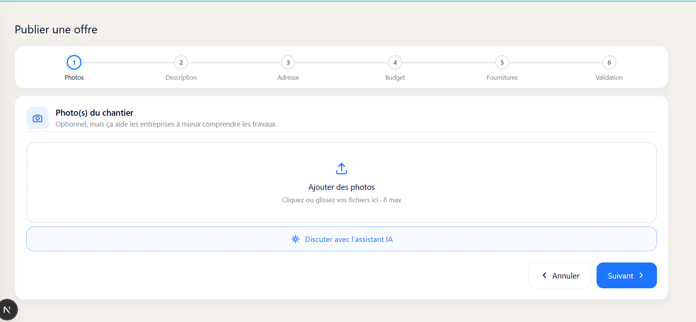
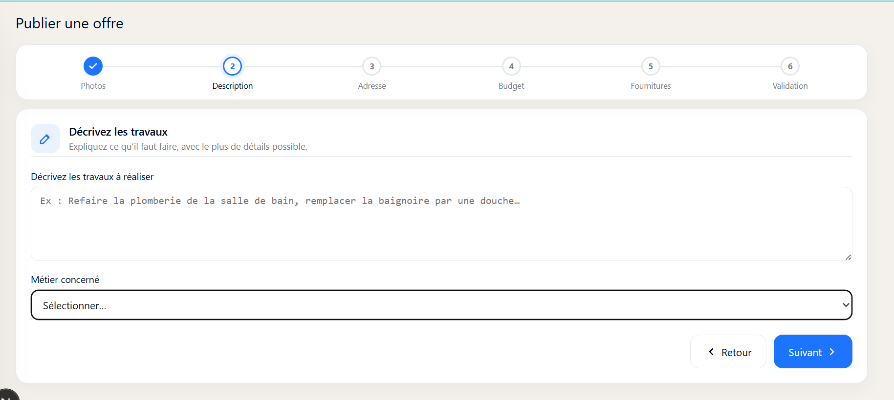
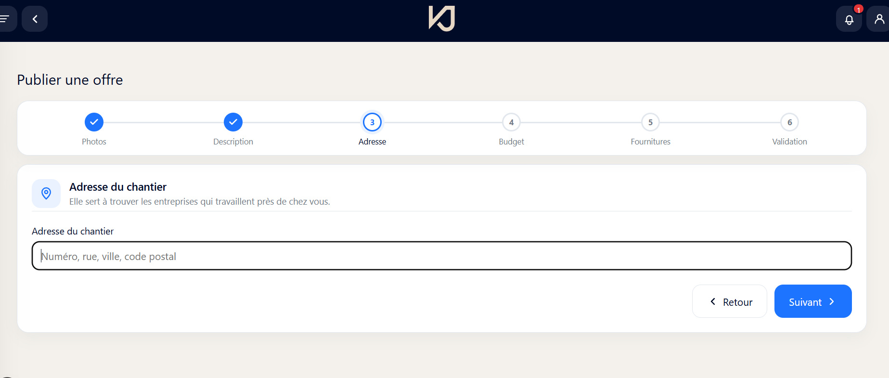
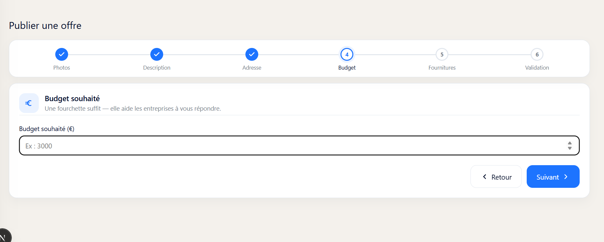
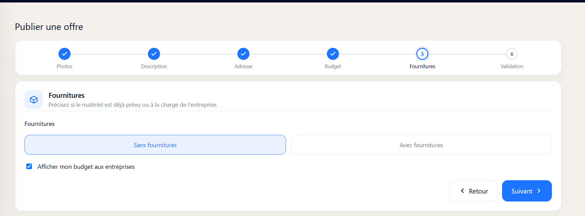
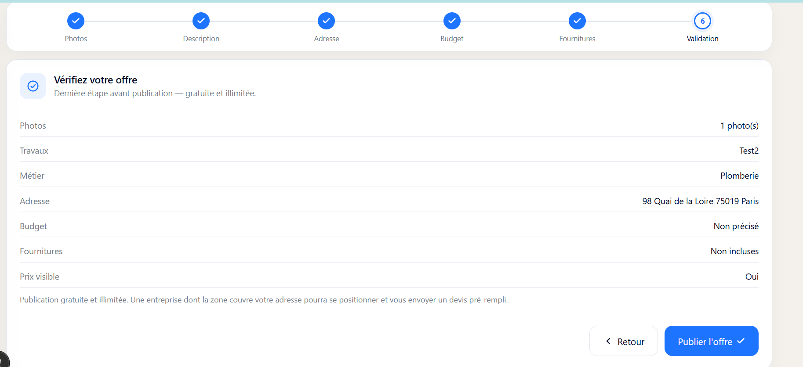
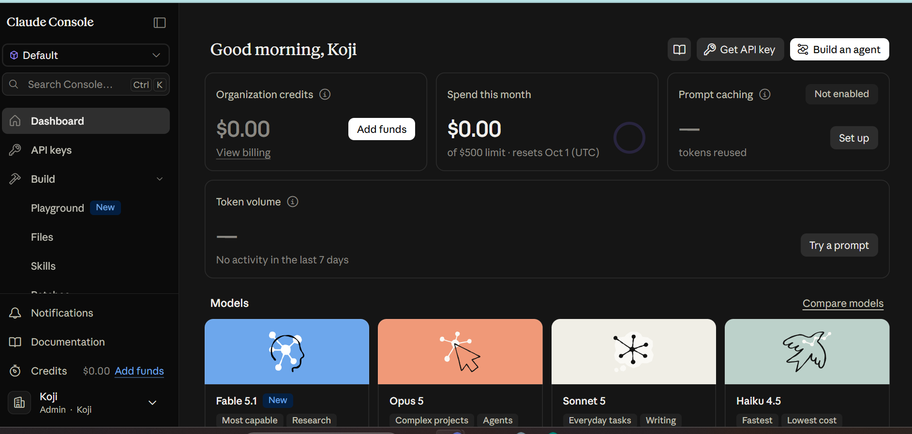

# KOJI — Interface Koji & Marketplace

**Rédigé par :** Amira
**Date :** 3-4 septembre 2026
**Objet :** Récapitulatif pour la réunion — pivot de la page de connexion, nouvelle interface Koji (particulier / Radar des Chantiers), Marketplace côté Koji Pro (entreprise), les deux briques IA, et le reste du parcours V1 (positionnement, zones, RDV, paiement échelonné).

**Important :** rien de ce qui suit n'a encore été poussé sur GitHub ni déployé. Tout est en local, testé au fur et à mesure, prêt à être relu avant mise en ligne.

---

## 1. Résumé du repositionnement

La page de connexion publique a été restructurée : **Koji** (profil particulier, porte d'entrée vers Radar des Chantiers) est maintenant l'interface mise en avant en premier, avec un slogan et une animation. **Koji Pro** (profil entreprise) est toujours disponible, mais réduit à une petite carte repliable en bas de la même page plutôt que d'être à égalité visuelle.

Les accès directs client (suivi de chantier signé) et ouvrier (pointage) restent entièrement fonctionnels — rien n'a été supprimé côté fonctionnalités — mais ils ne sont plus mis en avant sur cette page d'accueil : un particulier qui a déjà un chantier suivi avec une entreprise et un particulier qui vient chercher une entreprise via Radar des Chantiers utilisent désormais le **même compte Koji**.

---

## 2. Côté Koji (particulier) — Radar des Chantiers

### Ce qui existe aujourd'hui

- **Accueil simplifié** : un seul bouton "Publier une offre" + la liste "Mes offres", sans les anciens indicateurs de devis/chantiers qui n'avaient plus leur place ici.
- **Assistant de publication en 6 étapes**, conforme au cahier des charges (§3.1 — une information par écran) : Photos, Description + métier, Adresse (avec autocomplétion réelle via la Base Adresse Nationale), Budget, Fournitures, Validation.
- **Publication gratuite et illimitée**, sans quota ni palier payant (décision de Bilal du 2 septembre, déjà appliquée).
- **Fiche détail de chaque offre**, avec la liste des entreprises qui ont pris contact et l'historique de la discussion avec chacune.

### Parcours de publication — validé de bout en bout

Testé en conditions réelles (captures à l'appui) sur les 6 étapes :

1. **Photos** — dépôt de photo(s), avec le bouton "Discuter avec l'assistant IA" juste en dessous.



2. **Description** — texte libre + sélection du métier concerné (ex. Plomberie).



3. **Adresse** — champ avec autocomplétion réelle (Base Adresse Nationale).



4. **Budget** — montant souhaité, en euros.



5. **Fournitures** — "Sans" / "Avec" fournitures, + case à cocher pour afficher ou non le budget aux entreprises.



6. **Validation** — récapitulatif complet avant publication (photos, travaux, métier, adresse, budget, fournitures, visibilité du prix), avec le rappel "Publication gratuite et illimitée".



**Mon commentaire :** le parcours va bien jusqu'au bout sans blocage, chaque étape reprend correctement ce qui a été saisi à la précédente, et le bouton "Publier l'offre" est actif dès que les champs obligatoires (description, adresse) sont remplis. Aucun bug relevé sur ce parcours pendant les tests.

### Fichiers principaux

- `app/client/page.jsx` — accueil
- `app/client/radar/page.jsx` — liste "Mes offres"
- `app/client/radar/new/page.jsx` — assistant de publication
- `app/client/radar/[id]/page.jsx` — fiche détail + conversations
- `app/api/chantier-offres/route.js` — création/liste des offres
- `components/ClientTopbar.jsx` — menu simplifié (Accueil, Mes offres, Profil, Paramètres, Déconnexion)

---

## 3. Côté Koji Pro (entreprise) — Marketplace

Les entreprises voient les chantiers publiés par les particuliers via l'outil **Marketplace**, accessible depuis leur espace habituel.

- **`/marketplace`** : liste des chantiers disponibles (métier, adresse, budget si le particulier a choisi de le rendre visible, date de publication).
- **`/marketplace/[id]`** : fiche détail d'un chantier — photos, description complète, adresse, et surtout la possibilité de **contacter le client pour avoir plus de détails** : bouton d'appel direct, e-mail (révélé au clic), et discussion interne Koji.

### Fichiers principaux

- `app/marketplace/page.jsx` — liste des chantiers
- `app/marketplace/[id]/page.jsx` — fiche détail + contact + discussion
- `app/api/marketplace/offres/route.js` — liste (côté entreprise)
- `app/api/marketplace/offres/[id]/route.js` — détail (côté entreprise)

---

## 4. Discussion interne Koji, RDV et coordonnées

La messagerie entre une entreprise et un particulier fonctionne dans les deux sens (l'entreprise peut écrire, le particulier reçoit une **notification** et peut répondre depuis sa fiche d'offre). La notification reçue par le particulier indique déjà le nom de l'entreprise, son adresse, son site web si renseigné, et donne accès à sa carte de visite Koji si l'entreprise a un compte payant.

**Mise à jour : la prise de RDV et le partage des coordonnées, signalés comme en attente dans la version précédente de ce document, sont maintenant construits** (voir section 8 pour le détail) :

- Bouton **"Proposer un rendez-vous"** dans la discussion (date + heure), utilisable par les deux côtés. L'autre partie voit directement Accepter/Refuser sur la proposition.
- **Adresse exacte et coordonnées du particulier masquées tant qu'aucun RDV n'est confirmé** — l'entreprise ne voit que la ville et le code postal avant ça, conformément au cahier des charges (§5.4). Tout se débloque automatiquement dès qu'un RDV est accepté.

### Fichiers principaux

- `app/api/marketplace/offres/[id]/messages/route.js` — messagerie + RDV (entreprise et particulier)
- `app/api/marketplace/offres/[id]/entreprise-card/route.js` — carte de visite consultable par le particulier
- `app/api/marketplace/offres/[id]/route.js` — coordonnées gérées selon le RDV
- `lib/rdv.js` — détection d'un RDV confirmé pour un fil de discussion

---

## 5. Devis pré-rempli par IA (côté entreprise)

Sur la fiche d'un chantier, l'entreprise peut cliquer sur **"Générer un devis avec l'IA"**. Le système envoie à Claude la photo du chantier, sa description, et un extrait pertinent de notre bibliothèque de prix interne (métier concerné), puis crée directement un vrai devis (statut "Brouillon") dans l'éditeur existant — l'entreprise n'a plus qu'à l'ajuster et l'envoyer.

Extrait du schéma de réponse imposé à l'IA :

```
{
  "lots": [
    {
      "nom": "string",
      "postes": [
        { "designation": "string", "quantite": number, "prix_unitaire": number, "prix_total": number }
      ]
    }
  ],
  "prix_total_estime": number
}
```

### Fichiers principaux

- `app/api/estimer-devis/route.js` — génération et création du devis
- `lib/ouvrages.js` — bibliothèque de prix (extraite pour être partagée entre les deux briques IA)
- `lib/quote-mapping.js` — lien entre un devis généré par IA et l'offre d'origine

---

## 6. Nouveau : assistant IA côté particulier

À l'étape "Photos" de la publication d'une offre, un bouton **"Discuter avec l'assistant IA"** ouvre un vrai mini-chat. L'assistant pose une question à la fois (type de travaux, surface/unité, fournitures, budget), puis propose un résumé modifiable : description, métier, et une **fourchette de budget indicative** clairement marquée "estimation IA, non engageante" — jamais un chiffre ferme. Le particulier peut tout corriger avant de valider, et ça pré-remplit les étapes suivantes du formulaire (toujours modifiables ensuite).

*Point à signaler en réunion : le cahier des charges (§6) prévoyait volontairement de ne pas montrer d'estimation chiffrée au particulier en V1, faute de données réelles pour la calibrer. C'est un écart assumé, décidé pour pouvoir tester la mécanique dès maintenant.*

### Fichiers principaux

- `app/api/radar-assistant/route.js` — le chat
- `components/RadarAiAssistant.jsx` — l'interface de discussion

---

## 7. Claude Console — configuration

Un compte a été créé sur `platform.claude.com` (workspace "Koji"), avec une clé API générée et déjà branchée en local pour tester les deux fonctionnalités IA ci-dessus.



État actuel du compte (tableau de bord Console) :

- **Crédits organisation :** 0,00 $
- **Dépense ce mois-ci :** 0,00 $ sur une limite de 500 $ (renouvelée le 1er octobre, UTC)
- **Prompt caching :** non activé (pas nécessaire pour l'instant, optimisation à envisager plus tard si le volume augmente)
- **Volume de tokens :** aucune activité sur les 7 derniers jours
- **Modèles disponibles sur ce compte :** Fable 5.1, Opus 5, Sonnet 5 (celui utilisé par le code pour les deux briques IA), Haiku 4.5

**Point bloquant à régler avant de pouvoir tester en conditions réelles : il faut ajouter des crédits sur ce compte** — il est actuellement à 0,00 $, donc les deux boutons IA (devis entreprise et assistant particulier) renvoient une erreur "crédits épuisés" tant que ce n'est pas fait.

---

## 8. Positionnement, zones, RDV et paiement échelonné (fait depuis la dernière version)

Les 5 points listés comme ouverts dans la version précédente de ce document sont maintenant construits.

### Positionnement des entreprises

Bouton **"Se positionner"** sur la fiche chantier, premier arrivé premier servi. Plafond de **5 chantiers actifs simultanés** par entreprise (configurable, pas encore réglable depuis l'interface). Le particulier voit un badge "Positionnée" sur les entreprises concernées dans sa liste de conversations.

### Zones de travail par entreprise

Nouveau champ dans `/profil` : adresse de référence (avec autocomplétion) + rayon d'intervention en km. Une fois renseignée, `/marketplace` ne montre à l'entreprise que les chantiers dans son rayon **et** correspondant à l'un de ses métiers déclarés. Sans zone renseignée, rien ne change par rapport à avant (tous les chantiers restent visibles) — pas de régression pour les entreprises qui n'ont pas encore rempli ce champ.

### RDV et coordonnées post-RDV

Voir section 4 ci-dessus.

### Paiement échelonné (Stripe Connect)

Acompte / avancement / solde (répartition 30/40/30 du total du devis), créés automatiquement dès qu'un devis lié à une offre Radar des Chantiers est signé. Les fonds sont réglés par le particulier via Stripe (Checkout), **restent détenus par la plateforme Koji**, et ne sont reversés à l'entreprise (via un transfert Stripe Connect) qu'une fois le particulier ayant vu les photos envoyées par l'entreprise et validé l'étape — jamais de transfert automatique. Les entreprises configurent leur compte de réception des paiements (Stripe Connect, compte "Standard") depuis `/parametres/abonnement`.

**Point bloquant, à traiter avant de pouvoir tester cette partie : Stripe Connect doit être activé côté Dashboard Stripe**, avec un endpoint webhook dédié (`/api/webhooks/stripe-connect`) et son secret ajouté en variable d'environnement. C'est une action que je ne peux pas faire à ta place.

**Mon commentaire :** en construisant cette partie j'ai trouvé et corrigé deux bugs — les notifications de positionnement n'apparaissaient pas côté particulier (même souci que celui déjà rencontré pour les messages), et la route qui liste les entreprises positionnées sur un chantier n'avait aucune vérification d'authentification, ce qui aurait permis à n'importe qui de voir qui s'est positionné sur n'importe quelle offre. Les deux sont corrigés.

### Fichiers principaux

- `app/api/marketplace/offres/[id]/positionner/route.js` — positionnement
- `app/profil/page.jsx`, `lib/geo.js`, `app/api/marketplace/offres/route.js` — zones de travail
- `app/api/billing/connect/route.js`, `app/api/webhooks/stripe-connect/route.js` — onboarding et webhook Stripe Connect
- `lib/chantier-paiements.js` — création des échéances à la signature du devis
- `app/api/marketplace/offres/[id]/paiement/route.js` et sous-routes `[step]/checkout`, `[step]/valider` — paiement, photos, déblocage

---

## 9. Ce qui reste ouvert

- **Activer Stripe Connect côté Dashboard** (seul point bloquant restant pour tester le paiement de bout en bout).
- **Ajouter des crédits sur la Console Claude** (voir section 7) pour tester les deux briques IA.
- **Justificatifs d'assurance décennale vérifiés**, éventuelle **commission entreprise**, **notation des entreprises** — prévus en V3 par le cahier des charges, pas commencés.
- **Ouverture à de vraies entreprises externes** (V2) — nécessitera de revoir certains raccourcis pris pour la bêta interne (ex. plafond de positionnement non réglable depuis l'interface).

---

*Note sur les captures d'écran : je n'ai pas pu intégrer directement les copies d'écran échangées pendant nos échanges dans ce document — je n'ai pas accès aux fichiers images correspondants sur le disque, seulement à ce qui a été collé dans la conversation. Si tu veux des captures dans le document final, le plus simple est de les enregistrer toi-même (ou de me les repartager en tant que fichiers) et je les intègre.*
